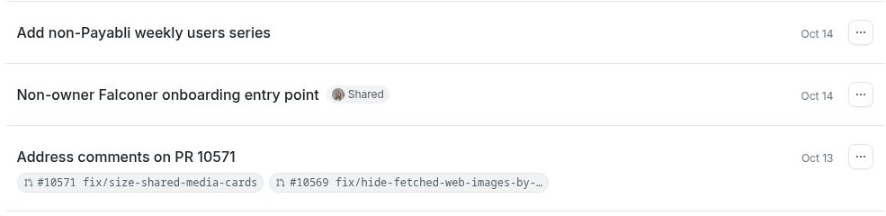

# Collaborate in conversations

Share a Falcon conversation so teammates can see its context and continue the discussion with Falcon. Conversations are private until you share them.

## Share with your organization

1. Open the conversation on the Falconer homepage.
2. Click **Share**. Falcon makes the conversation available to members of your organization and copies a link when your browser permits it.
3. Send the link to your teammates. They can read the history and add their own messages to the same conversation.

To stop organization-wide access, use **Make private** after sharing. A teammate who was separately given direct access may still have access.

## Bring someone into a chat

1. In the conversation, mention a teammate and write the question or task you want to discuss: “@Priya, can we review Falcon’s summary of the onboarding decision?”
2. If the teammate cannot see the conversation yet, choose **Share and send** to give them access and send your message. Choose **Continue without sharing** if you do not want to grant access.
3. Continue in the same conversation. Directly shared participants can read and reply, and may share it with other active organization members.

Shared conversations appear in a participant’s chat history. A participant can leave a shared conversation without deleting the owner’s chat.

## Check what you share

People with access can see the conversation history, including any answers or content you brought in from personal connections. A shared conversation does not give teammates access to your personal calendar or other connected accounts. Review the history before sharing, especially if it includes private meeting details or generated files.