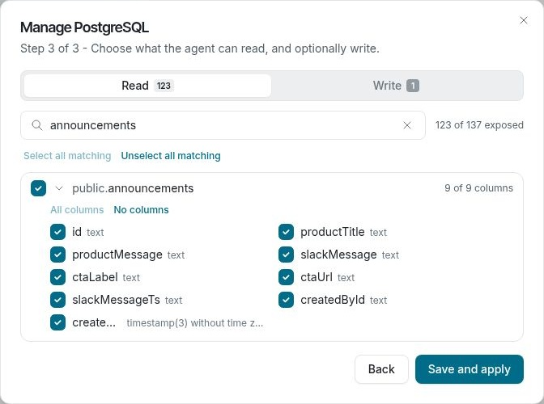

# Connect a database

Connect a PostgreSQL or MySQL database so Falcon can answer questions about the tables you allow it to access. Your workspace must have database connections enabled, and you need permission to manage integrations.

## Set up the connection

1. Open [Integrations](/integrations) and choose **PostgreSQL** or **MySQL**.
2. Choose how Falcon connects. **I’ll give Falconer a restricted user (recommended)** uses a database user you create and control. **Let Falconer manage permissions for me** uses an admin login once to create a restricted user; the admin password is not stored.
3. Enter the database connection details. If needed, configure TLS or an SSH tunnel. Select **Continue** to check the connection and discover accessible tables.
4. If Falconer manages permissions, select the tables and columns Falcon may read. Select any columns it may write to separately, then choose **Save and apply**. If you supplied your own restricted user, review the tables it can access and choose **Save**. To change that user’s access, change its database grants and save the connection again.
5. Ask Falcon a question, such as “How many orders were created last week?”

Falcon can query only what the connected database user can access. In the managed-permissions option, your table and column selections also define its access. Writes are limited to allowed columns and supported insert or update statements. Falcon presents a database write for your approval before running it, unless you have enabled auto-accept. Review the affected rows and statement carefully before approving.