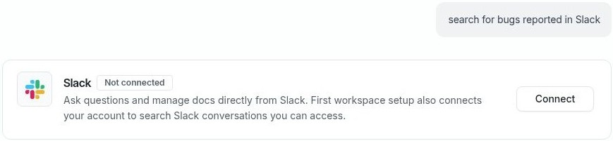

# Connect integrations with Falcon

Connect the tools Falcon needs while you are talking to it. Organization integrations share a source with your workspace. Personal connections, such as Gmail or Google Calendar, belong to your account.

## Connect from a conversation

1. In Falconer chat, tell Falcon which source you want to connect. For example: “Connect my Google Calendar” or “Connect Linear.”
2. Use the connection card Falcon shows in the conversation. If the source needs setup details first, complete its form in Falconer; otherwise, sign in and authorize access with the provider.
3. Complete any remaining source-specific setup, such as choosing pages or spaces. Falconer returns you to the conversation when setup is finished, and the card shows the current connection status.
4. Ask Falcon to use the newly connected source. For example: “What meetings do I have tomorrow?”

To browse sources yourself, open [Integrations](/integrations), choose the source, and follow its connection steps. Organization sources require permission to manage integrations; if you do not have it, ask a workspace admin to connect them. You can connect your own personal sources without that permission.

**Note:** Connecting from Falconer web chat returns you to that conversation. A connection started from a link in another app may leave you on the Integrations page instead. Some sources need more configuration before they are ready to use.