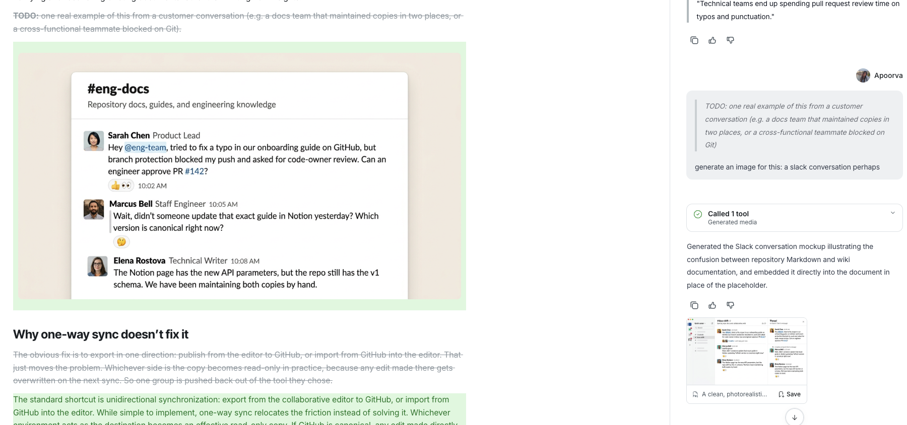

# Create and work with media

Ask Falcon to make images, short videos, or spoken audio in a conversation. You can also give Falcon an existing image or recording to work from.

## Generate an image or video

1. Tell Falcon what to create. Include the subject, style, composition, and any text you need in the image. For video, describe the motion and sound too. For example: “Create a simple illustration of our onboarding flow, with a light background and no text.”
2. To revise an image, attach it and describe the change: “Keep this composition, but make the background blue.” You can also ask Falcon to animate an image into a short video.
3. Review the result in the conversation. Ask for a change if needed.

Generation uses credits. Falcon can tell you the cost before making several items. Availability depends on your organization’s enabled media features.

## Create or improve voice audio

Ask Falcon to read a script aloud: “Record a calm voiceover for this announcement.” You can describe the voice or language you want. If you have a recording, attach it and ask Falcon to transcribe it or create a cleaner version in a different voice. Review the words before using a corrected recording.

## Keep or use the result

When Falcon adds an image to an existing article as a proposed edit, inspect it in the document diff before accepting the change.

1. Select **Save to library** on a finished media result you want to keep.
2. Ask Falcon to place an image, video, or audio result in a document if you want it alongside your text. Review the document’s sharing settings before sharing it.

Media left only in a conversation is temporary and may be deleted after 14 days. Saving it to your library or embedding it in a document keeps it available. Treat uploaded and generated media with the same care as the documents and conversations where you share it.