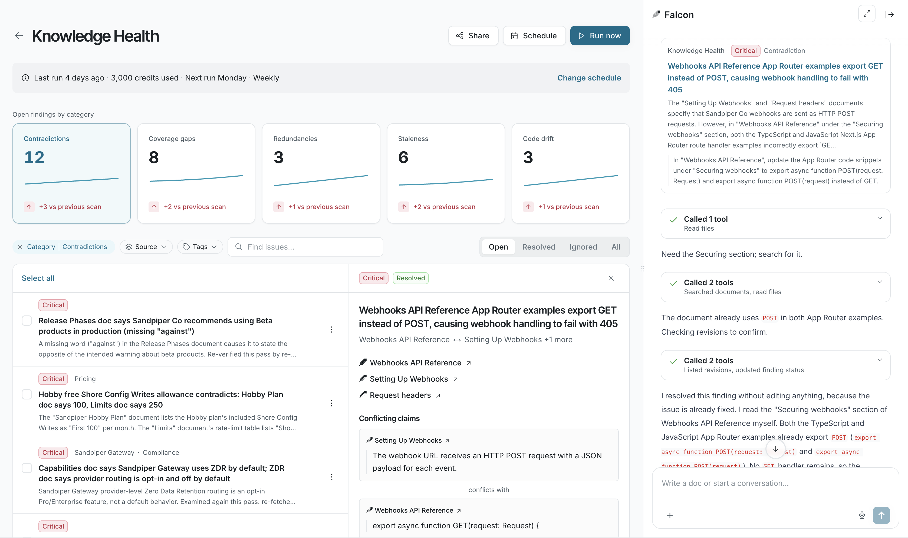

Assign a finding to Falcon to draft the fix, or triage it yourself.

## Fix an issue

1. Open the finding and click **Assign to Falcon**. The **Falcon** sidebar opens, and the button changes to **Falcon is working**.
2. If Falcon needs more information, such as which of two conflicting values is correct, it asks in the sidebar. Reply there.
3. Falcon shows its edit in the sidebar as a change to the doc, with **Accept** and **Reject**. When Falcon drafts a fix without help, the finding shows **Review proposed fix** instead, or **Review proposed document** for a coverage gap, and the doc opens with the change.
4. Click **Accept**. Until a draft is accepted, the finding shows **Fix under review**. If the finding is still open after you accept, click **Resolve**.

If **Assign to Falcon** is unavailable, hover over the button to see why. Usually the fix belongs in a tool Falcon doesn’t edit, such as a Notion or Confluence page. Make the change there, then click **Resolve**.

## Triage findings

| Action | When to use it |
| --- | --- |
| Change **Owner** | Assign the finding to the person who should fix it. |
| **Resolve** | You fixed the problem yourself. |
| **Ignore** | The finding isn’t a real problem, or doesn’t matter to your team. |
| **Reopen finding** | A resolved finding needs more work. |
| **Stop ignoring** | You ignored a finding by mistake. |

Each scan checks existing findings before it files new ones, so an ignored finding isn’t filed again.

## FAQ

<AccordionGroup>

<Accordion title="What should I do when a finding is wrong?">

Check its evidence, then click **Ignore**.

</Accordion>

<Accordion title="Can Falcon fix several findings at once?">

No. Falcon works on one of your findings at a time. While it works, you can resolve, ignore, or reassign other findings.

</Accordion>

</AccordionGroup>