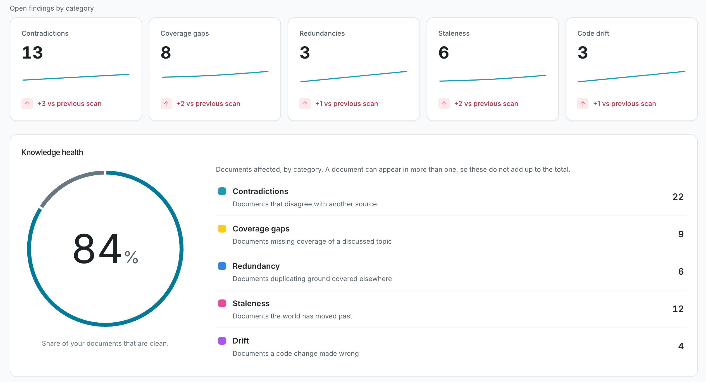
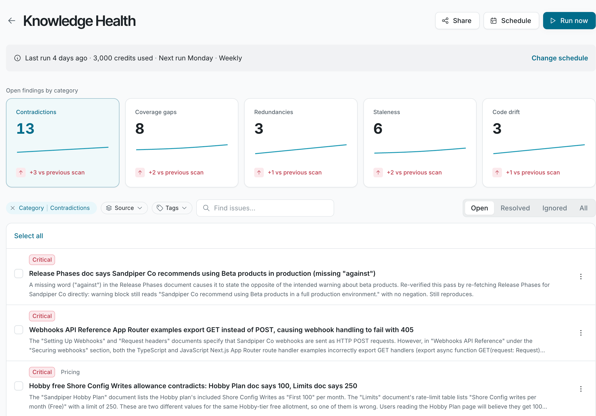
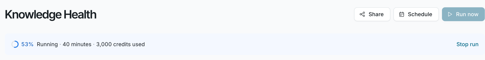

See what the Knowledge Health page shows, and what each run status means.

Select **Knowledge Health** in the sidebar.

## What the page shows

- **Run banner:** the status of the latest scan. See [Run status](#run-status).
- **Open findings by category:** a count for each category, with the change since the previous scan. Click a category to list its findings.
- **Knowledge health:** a donut with the share of your documents that are clean, meaning examined documents with no open finding, and the number of documents affected in each category. A document can have more than one kind of problem, so the category counts can add up to more than the number of affected documents. The donut shows **Not scored yet** until at least 10 documents have been examined.
- **Findings list:** each finding with its severity, title, and summary. Filter it with **Open**, **Resolved**, **Ignored**, or **All**.

Findings appear while a scan is running, so you can start reviewing before it finishes.

## Run status

| Status | What it means |
| --- | --- |
| **Knowledge Health queued** | Other scans are ahead of yours. It starts on its own. |
| **Knowledge Health running** | A scan is in progress. The banner shows progress, elapsed time, and credits used so far. |
| **Knowledge Health paused** | Credits ran out. The scan resumes when credits are added. See [Knowledge Health credits](/knowledge-health/manage/credits). |
| **Last run** and **Next run** | No scan is active. The banner shows when the last scan ran, the credits it used, and when the next scheduled scan starts. |

