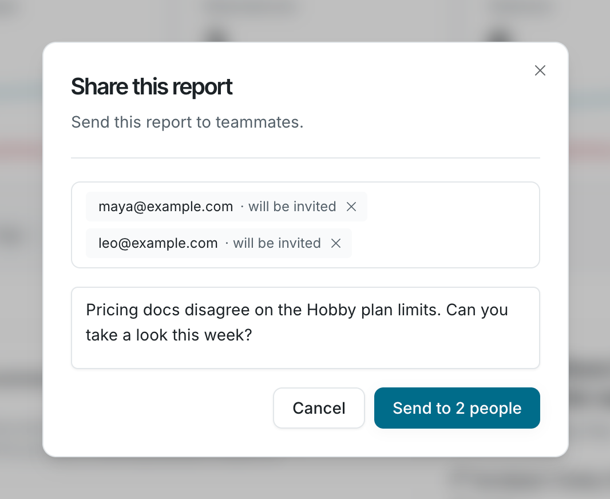

Send the Knowledge Health report to teammates or outside reviewers.

Any member can share the report.

## Share the report

1. On the **Knowledge Health** page, click **Share**. The button appears once your organization has a report.
2. In **Share this report**, search for teammates by name or type an email address. You can add up to 20 people. People outside your organization get an invite when you send, and see the report once they join.
3. Add an optional note, then click **Send**. The button shows the number of recipients, such as **Send to 2 people**.

Members get **Knowledge Health report shared with you** in their Falconer inbox and by email. Everyone else gets an invite to join as a member. Both link to the live **Knowledge Health** page, not a snapshot. 