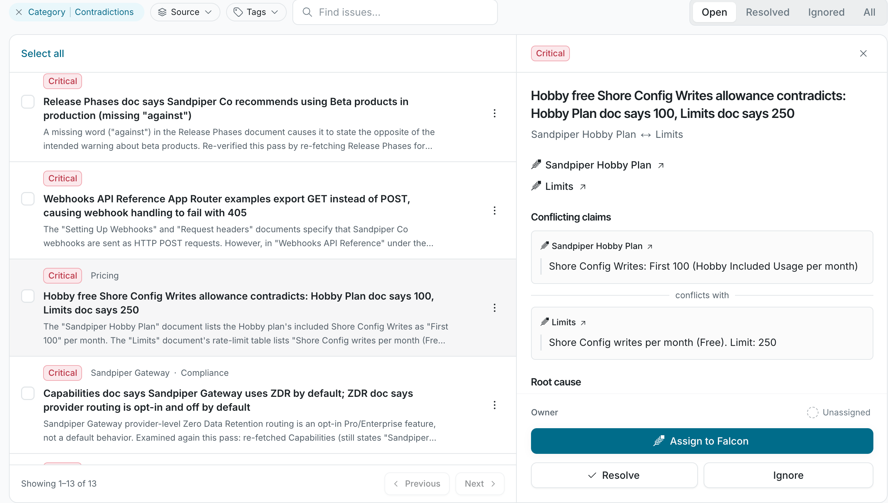

Open a finding to see what Knowledge Health found, the evidence behind it, and what to change.

Click a finding in the list to open its details.

## What a finding shows

| Part | What it shows |
| --- | --- |
| **Category** | **Contradiction**, **Stale doc**, **Coverage gap**, **Redundancy**, or **Code drift**. See [Categories](/knowledge-health/overview#categories). |
| **Severity** | **Critical**, **Moderate**, or **Low**. |
| **Evidence** | Quotes from each source. A contradiction shows both claims side by side. |
| **Why it matters** | The effect on the people and agents who read the doc. |
| **Suggested action** | What to change to resolve it. |
| **Sources** | Links to the cited docs, code files, and pull requests. |
| **Owner** | The person responsible for the finding. It defaults to the doc owner. |

Each quote links to its source, so you can check it before you act.

## Finding status

| Status | What it means |
| --- | --- |
| **Open** | Not yet resolved or ignored. |
| **Falcon is working** | Falcon is drafting a fix. |
| **Fix under review** | Falcon’s draft is waiting for someone to accept it. |
| **Resolved** | The problem is fixed. |
| **Ignored** | Someone marked the finding as not a real problem. Later scans don’t file it again. |

To change a finding’s status, see [Fix and triage findings](/knowledge-health/find-issues/fix-and-triage-findings).

If a resolved problem comes back, the next scan files a new finding instead of reopening the old one. Resolved and ignored findings are archived 30 days after their status changes.

## FAQ

<AccordionGroup>

<Accordion title="How accurate are findings?">

Each finding quotes its evidence, so you can check it. With your codebase connected, Knowledge Health also checks doc claims against the code. See [Connect sources](/knowledge-health/set-up/connect-sources).

</Accordion>

</AccordionGroup>