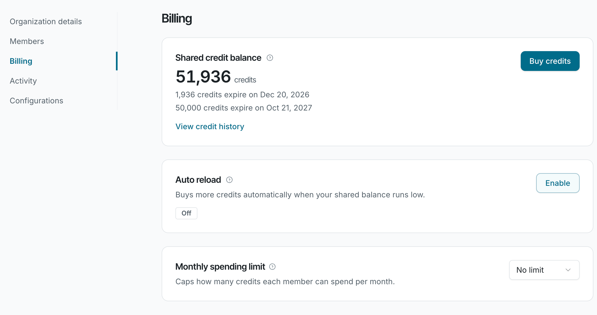
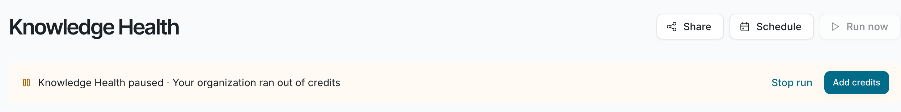

See what a Knowledge Health scan costs, how to add credits, and what happens when they run out.

Knowledge Health is billed by usage. Each scan uses credits from your organization’s balance as it works.

## What a scan costs

A scan is billed for the AI model usage it records, not per document, so a scan over more sources uses more credits.

Before a scan starts, **Run now** shows an **Estimated cost** range and your **Credit balance**. After it ends, the run banner shows the credits it used. Scheduled scans use the same balance.

If your organization uses its own model provider key, your provider bills you for model usage. Other platform operations, such as embeddings, still use Falconer credits.

## Add credits

You need to be able to manage billing. Open **Settings**, choose **Organization settings**, then **Billing**. Click **Buy credits**, or turn on **Auto reload** to buy credits automatically when your balance runs low.

See [Buy credits and manage auto reload](/plans-and-pricing/buy-credits-and-auto-reload) and [Track usage and set spending limits](/plans-and-pricing/usage-and-spending-limits). For pricing and how long credits last, see [How credits work](/plans-and-pricing/how-credits-work).

## When credits run out

| When | What happens |
| --- | --- |
| Before a scan | If your balance is below the low end of the estimate, the **Run now** window warns that the scan will pause when your credits run out. |
| During a scan | The scan pauses and keeps its findings. People who can manage billing get **Knowledge Health paused**. The scan resumes when credits are added and doesn't expire while it waits. It ends only if someone stops it or a new scan replaces it. |
| When a scheduled scan is due | The scan is skipped, and no one is notified. |
| With no credits at all | The page shows **Add credits to run Knowledge Health** with an **Add credits** button. |

To avoid pauses, turn on **Auto reload**.

## Stop a scan

Click **Stop run** in the run banner, then confirm in **Stop this run?**. Findings filed so far are kept. Credits already used aren’t refunded.

## FAQ

<AccordionGroup>

<Accordion title="How many credits does a scan use?">

It depends on the size of your sources. There’s no fixed price per scan or per document. **Run now** shows an estimated range before each manual scan.

</Accordion>

<Accordion title="Does my own model key make Knowledge Health free?">

No. Your provider bills you for model usage, which lowers your Falconer credit usage. Other platform operations still use Falconer credits.

</Accordion>

</AccordionGroup>