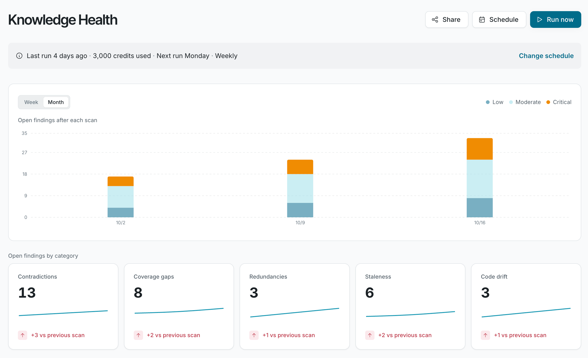
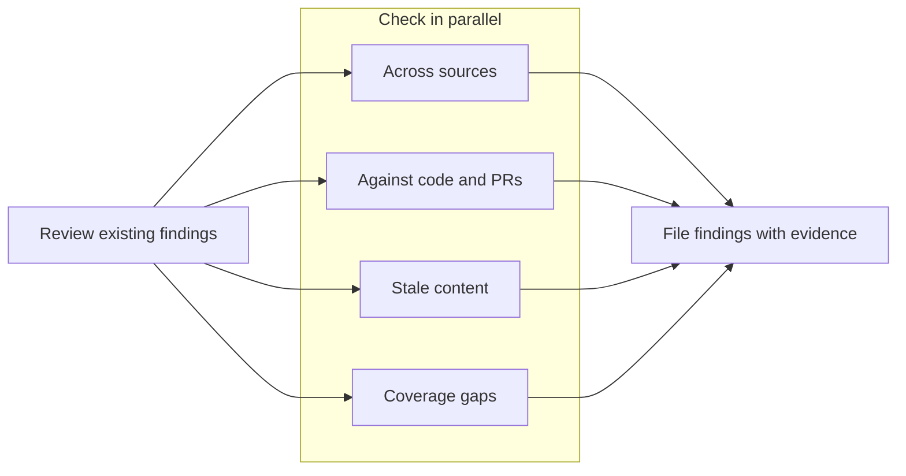

Find contradictions, gaps, and stale pages across your docs, code, and connected sources.

## How it works

Knowledge Health scans your connected sources, compares them with each other and with your code, and finds existing issues.

Start a scan with **Run now**, or put scans on a schedule. You can assign any finding to Falconer, which drafts the proposed fix for you to review. You can also fix issues with your preferred coding agent through the Falconer MCP.

## Prerequisites

- At least one connected source.
- Credits in your balance, or your organization’s own model provider key.

**Run now** and **Schedule** appear on the Knowledge Health page when your organization uses credits or its own model provider key.

## Categories

| Category | What it means |
| --- | --- |
| **Contradiction** | Two sources make claims that can’t both be true. |
| **Stale doc** | A doc describes knowledge that has since changed. |
| **Coverage gap** | A topic comes up in Slack, meetings, code, or tickets, but no doc covers it. |
| **Redundancy** | The same knowledge is documented in more than one place. |
| **Code drift** | A doc no longer matches what the code does. |

## How a scan works

1. Knowledge Health checks the findings it already filed, so it doesn’t report the same problem twice.
2. It compares your sources with each other and with your code, and checks recent pull requests.
3. It files findings as it goes. The scan keeps running if you leave the page.

## See more

- **Set up:** [run your first scan](/knowledge-health/set-up/run-your-first-scan), [connect sources](/knowledge-health/set-up/connect-sources), and [schedule scans](/knowledge-health/set-up/schedule-scans).
- **Find issues:** [read the Knowledge Health page](/knowledge-health/find-issues/read-the-page), [understand a finding](/knowledge-health/find-issues/understand-a-finding), and [fix and triage findings](/knowledge-health/find-issues/fix-and-triage-findings).
- **Manage:** [Knowledge Health credits](/knowledge-health/manage/credits), [notifications](/knowledge-health/manage/notifications), and [troubleshooting](/knowledge-health/manage/troubleshooting).

## FAQ

<AccordionGroup>

<Accordion title="What data does Knowledge Health read?">

Only the sources you connect. You choose which repositories, folders, documents, and Slack channels Falconer can read.

</Accordion>

<Accordion title="Does a scan change my docs or code?">

No. A scan only reads. When you assign a finding to Falcon, it drafts the change, and nothing changes until you accept it.

</Accordion>

<Accordion title="Is my data used to train AI models?">

No. Falconer doesn’t train on customer data.

</Accordion>

<Accordion title="Which security certifications does Falconer have?">

Falconer is SOC 2 Type II certified, and data is encrypted in transit and at rest. HIPAA compliance, single-tenant, and self-hosted deployments are available. See [trust.falconer.com](https://trust.falconer.com).

</Accordion>

</AccordionGroup>