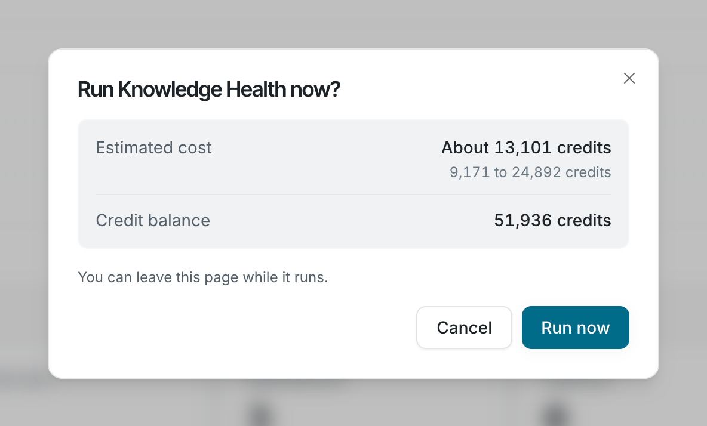

Run a Knowledge Health scan during sign-up or from the Knowledge Health page, then open the report.

## Run a scan during sign-up

1. Sign up for Falconer and choose **Fix outdated docs**.
2. Point Falconer at your docs using one of the options in setup, then finish setup.
3. The scan starts in the background. A progress window shows each step and the number of findings so far, and the report opens when the first findings are ready.

When the report is ready, Falconer sends you a **Knowledge Health report ready** notification in your inbox, by email, and in Slack.

## Run a scan from Knowledge Health

You need at least one connected source that has finished indexing, and credits in your balance.

1. Select **Knowledge Health** in the sidebar.
2. Click **Run now**. The **Run Knowledge Health now?** window shows the **Estimated cost** and your **Credit balance**.
3. Click **Run now** in the window. The run banner shows progress, and findings appear as they’re filed.

If your balance is below the low end of the estimate, the window warns that the scan will pause when your credits run out. See [Knowledge Health credits](/knowledge-health/manage/credits).

If **Run now** is missing, or the page asks you to connect a source or add credits, see [Troubleshooting](/knowledge-health/manage/troubleshooting).