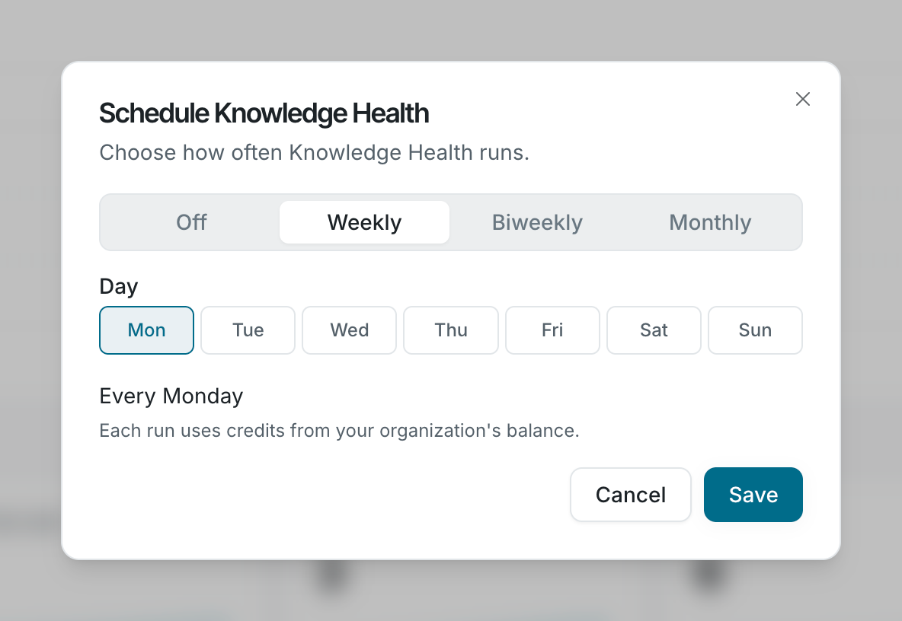

Run Knowledge Health weekly, biweekly, or monthly, on a day you choose.

Your organization’s schedule is off until a member turns it on. Any member can change it.

## Set a schedule

1. On the **Knowledge Health** page, click **Schedule**. The **Schedule Knowledge Health** window opens.
2. Choose **Weekly**, **Biweekly**, or **Monthly**.
3. For a weekly or biweekly schedule, pick a day of the week. For a monthly schedule, pick a day from the 1st to the 28th, or **Last day**. The window sums up your choice, such as **Every Monday**.
4. Click **Save**.

## When scans start

Scheduled scans start at 08:30 UTC on the chosen day. When many scans fall on the same day, a start can be delayed by up to 12 hours. You can’t choose the time of day a scan runs.

## Change or turn off the schedule

Click **Schedule** again and choose a new frequency, or choose **Off**. With the schedule off, Knowledge Health runs only when someone clicks **Run now**.

The run banner shows **Next run** with the date of the next scheduled scan, or **No schedule** with a **Set schedule** button.

## FAQ

<AccordionGroup>

<Accordion title="Do I pay for scheduled scans?">

Yes. Scheduled scans use the same credit balance as **Run now**. If the balance is empty when a scan is due, the scan is skipped. See [Knowledge Health credits](/knowledge-health/manage/credits).

</Accordion>

</AccordionGroup>