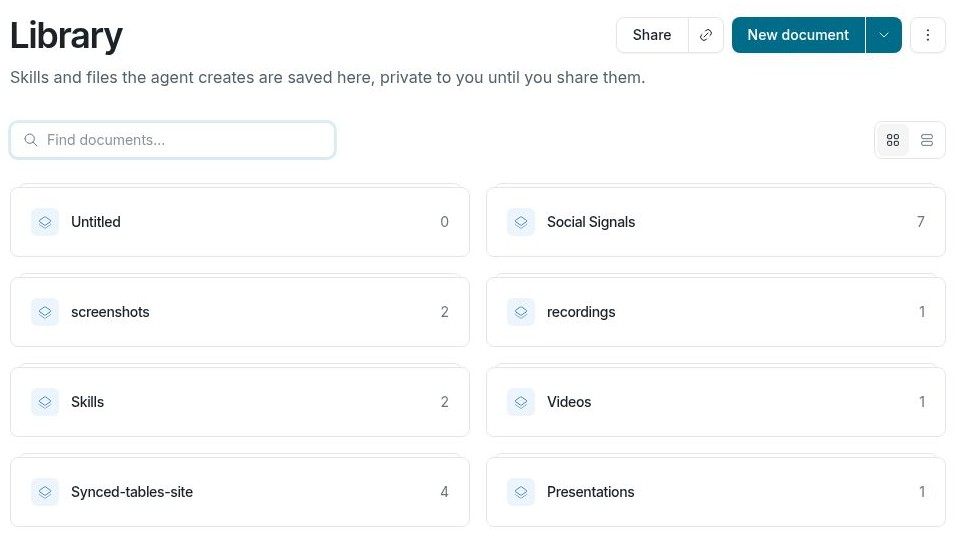

# Manage Library files

Keep finished files in your Library so they are available beyond the conversation that produced them. Save a report, image, or export you want to reopen; temporary working files do not need to become Library files.

## Add and open a file

1. Open **Library** in the navigation sidebar. Use **Upload file** to add a file, or drag a supported file into the Library. Create a folder when you want to group related files.
2. Select a file to open its preview. Use **Download** to keep a copy on your device.

You can also ask Falcon to save a finished file to your Library. For example: “Save the finished HTML report to my Library in a Reports folder.” When Falcon shows generated media in a conversation, use its save control if you want to keep it. A file attached to a conversation is an input; save the result you want to retain.

## Update a saved file

Open the file’s menu and choose **Replace file** to upload a new version, or **Rename** to change its name. When Falcon saves a file with the same name in the same Library folder, it replaces the existing file while keeping its link. Check the finished file before replacing one that others use.

## Share access

Library files start in your private Library. To share one, open the file and click **Share**, or choose **Share** from its navigation menu. If **Inherit permissions** is on, the file follows its containing folder’s access. Turn it off to set access for this file, then add a person or group under **People with access** and choose the permission they need. The share dialog also lets you manage the file’s owner and **General access**, including organization and link access where permitted.

Use **Copy share link** after setting access. A link alone does not give someone permission unless link access allows it. Before enabling **Anyone with the link**, check that the file is suitable for public viewing. Folder permissions may also affect files that still inherit them.

To remove a file you no longer need, choose **Delete** from its menu. Delete deliberately if the file has been shared or linked from another place.