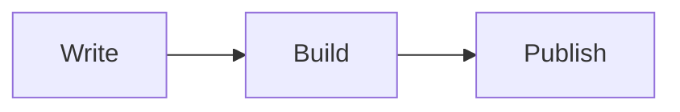

Every block that renders on a published site, with the syntax to write it.

Pages are the documents you write in Falconer or sync from a repository. In an `.mdx` file, write the tags below; in the Falconer editor, the same blocks are available as rich components. The site renders everything on this page. A component that isn't listed, or one that uses an attribute Falconer doesn't know, shows as an MDX code block.

These are the same components that [two-way sync](/two-way-sync/supported-markdown) reads from a repository, so a page written for Mintlify renders without changes.

## Markdown

Headings with anchor links, paragraphs, bold, italic, strikethrough, inline code, lists, task lists, tables, blockquotes, links, images, emoji, and code blocks with syntax highlighting. Links between pages and images are resolved by path; see [Write pages](/public-docs/write-pages#links-between-pages).

## Callouts

A box that stands out from the text. Write a blockquote with a type marker, or use a component tag.

```mdx
> [!TIP]
> Save a build before you change the custom domain.

<Warning>
This can't be undone.
</Warning>
```

| Type | Markers and tags |
| --- | --- |
| Note | `[!NOTE]`, `<Note>`, `<Info>` |
| Tip | `[!TIP]`, `<Tip>` |
| Check | `[!CHECK]`, `<Check>` |
| Warning | `[!WARNING]` |
| Caution | `[!CAUTION]`, `<Warning>` |
| Danger | `[!DANGER]` |
| Update | `[!UPDATE]`, `<Update>`, for changelog entries |

## Accordions

Collapsible sections, good for FAQs and optional detail. Wrap several in an `<AccordionGroup>` so they sit together; a single one stands alone.

```mdx
<AccordionGroup>
<Accordion title="Can I use my own domain?">
Yes. See the custom domain page.
</Accordion>
<Accordion title="Is there a free tier?">
The site itself is included; add-ons are billed in credits.
</Accordion>
</AccordionGroup>
```

## Tabs and code groups

Switchable panels. Each tab needs a `title`.

```mdx
<Tabs>
<Tab title="npm">
Run `npm install @acme/sdk`.
</Tab>
<Tab title="pnpm">
Run `pnpm add @acme/sdk`.
</Tab>
</Tabs>
```

A `<CodeGroup>` holding several code blocks renders as tabs too, one per block, labeled with the block's title.

## Steps

A numbered walkthrough. Each `<Step>` takes an optional `title` and holds any Markdown.

```mdx
<Steps>
<Step title="Create an API key">
Open **Settings** and choose **API keys**.
</Step>
<Step title="Call the API">
Send the key in the `Authorization` header.
</Step>
</Steps>
```

## Cards and columns

A card is a bordered box with an optional icon, link, and call to action. When it has a link, the whole card is clickable.

```mdx
<Card title="Quickstart" icon="rocket" href="/get-started/quickstart" cta="Start here">
Publish your first site in ten minutes.
</Card>
```

- `icon` is a [Tabler icon](https://tabler.io/icons) name.
- `href` or `url` is the destination; `cta` labels the link.
- `horizontal` lays the icon beside the content.

Put cards side by side in a `<CardGroup cols={2}>`, or any content side by side in `<Columns cols={2}>` with a `<Column>` for each. `cols` is the number of columns.

## Frames

A `<Frame>` centers an image with a border, and an optional `caption` under it.

```mdx
<Frame caption="The site card on a space">
  
</Frame>
```

## Video, audio, and embeds

```mdx
<video src="https://example.com/demo.mp4" title="Product demo" controls></video>

<audio src="https://example.com/voiceover.mp3" controls></audio>

<iframe src="https://www.youtube.com/watch?v=dQw4w9WgXcQ"></iframe>
```

A YouTube link in an `<iframe>` becomes an embedded player. Any other `<iframe>` is rendered as a frame of that page.

## Math

Inline formulas go between single dollar signs, block formulas between double dollar signs, and both render with LaTeX.

```md
The area is $\pi r^2$.

$$
E = mc^2
$$
```

## Diagrams

A code block with the `mermaid` or `d2` language renders as a diagram. If a diagram can't be drawn in the visitor's browser, its source is shown instead.

````md

````

## Raw HTML

An `<Html>` block is rendered on the page exactly as written. Use it for an embed or a layout that the components above can't express.

## API reference pages

A page can render one operation, or one schema, from an OpenAPI document. Put the document in the site's **Files** view and point at it from the page's frontmatter.

```yaml
---
title: Create a user
openapi: api/openapi.yaml POST /users
---
```

```yaml
---
title: The User object
openapi-schema: api/openapi.yaml User
---
```

- The operation is `METHOD /path`. The method can be GET, PUT, POST, DELETE, PATCH, OPTIONS, HEAD, or TRACE.
- The schema is a name under `components.schemas`, and it has to be an object schema.
- The document path is relative to the root of **Files** and has to end in `.json`, `.yaml`, or `.yml`. URLs aren't accepted.
- Leave the path out to use the document named in `docs.json` (`api.openapi`) or `mint.json` (`openapi`).
- The page's title is the operation's summary, and the opening text is the operation's description, unless the page has its own.

The page shows the authorization, parameters, request body, and responses, with examples. OpenAPI 3.0 and 3.1 are supported; Swagger 2.0 isn't. Documents can be up to 10 MB, schemas are expanded six levels deep, and `allOf`, `oneOf`, and `anyOf` compositions are shown but not expanded. A page whose document or operation can't be found shows an error in its place and leaves the rest of the build untouched.