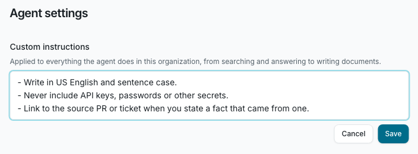
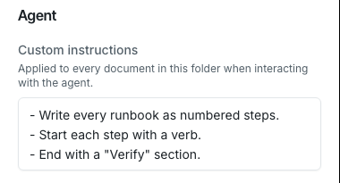
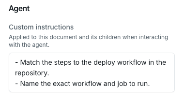

Custom instructions are rules that the Falconer agent follows.
Use them to keep agent writing consistent, for example "Write in US English" or "Never include API keys or passwords".

You can set rules at four levels: the organization, a Space, a folder and a document.
A document gets the rules of every level above it, so you write a rule once and it applies to all the documents below it.

## Where to set custom instructions

| Level | Where to find it | Who can change it | What the rule covers |
| --- | --- | --- | --- |
| **Organization** | **Settings → Organization settings → Agent settings** | Organization owners | Everything the agent does in your organization: how it searches, what it answers and every document it writes |
| **Space** | Open the Space, click the more button (**⋮**), then **Details → Agent** | Organization owners who can edit the Space | Writes to every document in the Space |
| **Folder** | Open the folder, click the more button (**⋮**), then **Details → Agent** | Anyone who can edit the folder | Writes to every document in the folder and its subfolders |
| **Document** | Open the document, click the more button (**⋮**), then **Details → Agent** | Anyone who can edit the document | Writes to the document and to documents nested under it |

Each level has one **Custom instructions** field of up to 2,000 characters.
Write one rule per line.
Members who cannot edit a level see its rules as read-only text.

### Organization

1. Go to **Settings → Organization settings → Agent settings**.
2. Enter your rules under **Custom instructions**.
3. Click **Save**.

To remove the rules, clear the field and click **Save**.

### Space or folder

1. Open the Space or folder.
2. Click the more button (**⋮**) and select **Details**.
3. Enter your rules in **Custom instructions** under **Agent**.

The rules save when you click outside the field.

### Document

1. Open the document.
2. Click the more button (**⋮**) on the top right corner and select **Details**.
3. Scroll to **Agent** and enter your rules in **Custom instructions**.

The rules save when you click outside the field.

## How rules combine

When the agent writes to a document, it follows every rule that applies to that document, in this order:

1. The organization rules
2. The rules of each Space and folder above the document, from the top down
3. The document's own rules, and the rules of any document it is nested under

For example, a runbook in the **Runbooks** folder gets the organization rules, the **Runbooks** folder rules and its own rules.

- **Rules add up.** A folder rule does not replace the organization rule. The agent follows both.
- **Organization rules always apply.** A Space, folder or document rule cannot relax them.
- **The most specific rule wins a real conflict.** A document rule wins over its folder, and a folder rule wins over the folder or Space it sits in.
- **A rule about one kind of write covers only that kind.** For example, a rule for new documents does not ask the agent to change an existing document.
- **Private sections get the organization rules only.** Folder and document rules apply to documents in your company navigation, not to documents that are only in a private section.

If a write cannot satisfy every rule, the agent does not write.
It stops and tells you which rule blocked it.

## What follows custom instructions

| Where the agent works | What it uses |
| --- | --- |
| Falcon in the app, in Slack and in Mattermost | The organization rules for every request. The rules of a document when it creates or edits that document. |
| Auto-update drafts from pull requests | The rules of each document. A proposed edit that breaks a rule is dropped. |
| Knowledge Health | The rules of each document. If a fix would break a rule, Falcon leaves the finding pending and names the rule. |
| MCP, the public API and the CLI | The rules of each document, returned with every read and checked on every write. See [Use custom instructions from MCP, the API and the CLI](#use-custom-instructions-from-mcp-the-api-and-the-cli). |

The [Ask the docs](/public-docs/ask-the-docs) assistant on a public docs site does not use custom instructions.

Custom instructions guide the agent. Review agent changes the same way you review any other change.

## Use custom instructions from MCP, the API and the CLI

External agents, such as Claude Code or Cursor connected through [MCP](/mcp-and-cli/quickstart), get the same rules as Falcon.

- **Reads return the rules.** `read` (MCP) and `GET /docs/{id}` (API) return a `customInstructions` object before the document content. It has a `rulesHash`, the precedence text and the list of `rules`, each with its `level` (`org`, `space`, `folder` or `document`), its `name` and its `instructions`.
- **Folders return the rules for new documents.** `get_folder` (MCP) and `GET /folders/{folderId}` (API) list the rules a new document in that folder gets.
- **Writes send the hash.** Pass the `rulesHash` as `customInstructionsHash` on every create and edit. In the CLI, use `--custom-instructions-hash`.
- **A write without the current hash is refused.** The API returns `412` with the code `custom_instructions_required` and the current rules, and writes nothing. The agent checks its write against the rules and retries with the new `rulesHash`.
- **Documents with the same rules share one hash.** Pass `customInstructionsHash` on a read to skip rules you already have. If the rules have not changed, the response says `unchanged: true` instead of repeating them.

To read or change rules, use `read_settings` and `edit_settings` (MCP) or `GET` and `PATCH /settings/{scope}` (API).
The `org`, `space`, `folder` and `document` scopes each have a `customInstructions` key.
A read returns the level's own rule as `value` and every rule that applies, organization first, as `effectiveValue`.
A change to the organization rules must be sent again with `confirmed: true` before it is saved.

## Troubleshooting

**The agent did not follow a folder or document rule**

- Make sure the document is in your company navigation. Documents that are only in a private section get the organization rules only.
- Check the rules of every level above the document. The Details panel shows only the rule set on that level, not the rules it inherits. `read_settings` shows all of them as `effectiveValue`.

**I cannot change the Space rules**

Only organization owners can change a Space's custom instructions.

**An MCP or API write fails with `custom_instructions_required`**

The rules changed since the agent last read them, or the write did not include `customInstructionsHash`.
Read the document again, check the write against the rules and retry with the new `rulesHash`.

Slack Q&A channels have their own per-channel instructions, set in the Slack integration settings. They are separate from custom instructions.
