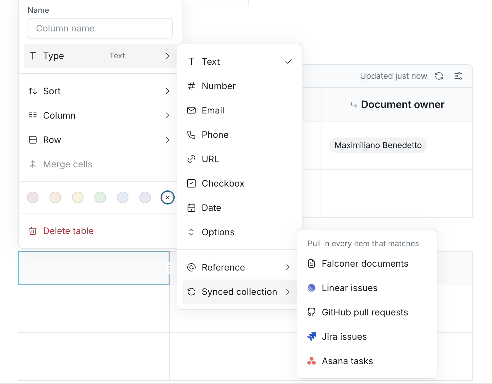
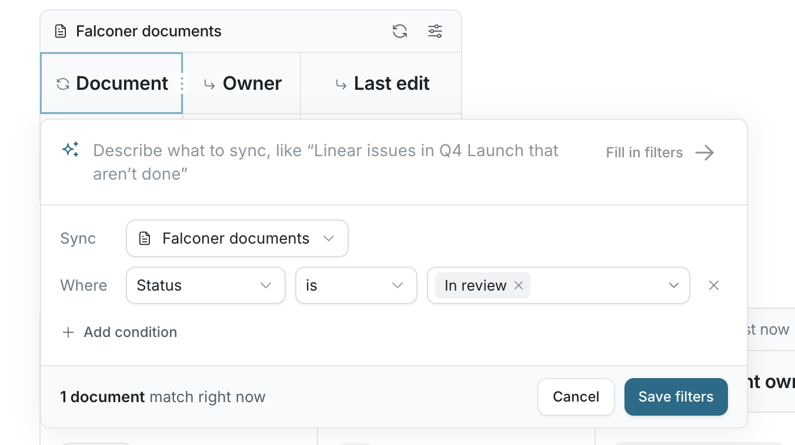

# Sync a table with work

A synced collection keeps selected rows in a Falconer document aligned with work you can access in a connected source. Use it for a recurring review, such as open Linear issues in a project, rather than copying a status list by hand.

## Set up a synced collection

1. Open a doc you can edit and create a table with **/**, then **Table**. Use a header row.
2. Open the header menu for the column that will hold each issue, pull request, or document. Choose **Type**, then **Synced collection**.
3. Choose a source, such as **Linear issues**, **GitHub pull requests**, or **Falconer documents**. Other sources appear when available to your organization.
4. In the filter editor, select conditions that define the rows you want. For example, choose a Linear project and a status. You can also describe the view in words and click **Fill in filters**, then check the proposed conditions. The editor shows how many items currently match.

1. Click **Sync rows**. Falconer adds a row for each matching item you can access.
2. Add a new column for a changing detail. From its header menu, choose **Type**, then **Lookup**, the synced reference column, and an attribute such as **Status** or **Assignee**. Keep another plain text column for your own notes or decisions.

For Asana tasks, select a project in the filters. A source must be connected and available before it can return its items.

## Refresh or change the view

The bar above the table identifies its source and filters. An editor checks the collection when opening the doc and can click **Refresh** in that bar to check again. Click **Edit filters** there to change which items match. The table is not a live, second-by-second feed.

Synced rows follow the source and filters. Keep personal commentary in separate columns: those values remain yours. Rows you add by hand also remain when the collection refreshes. People who can only view the doc cannot refresh its rows; an editor’s access to the source determines which items are brought into the shared document. Check the source permissions before placing sensitive work in a document with a wider audience.

If **Synced collection** is not in the **Type** menu, the feature is not enabled for your organization. You can still use an ordinary table for a manually maintained list.