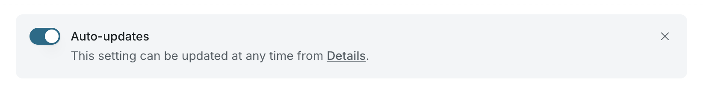
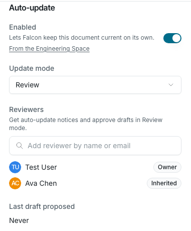
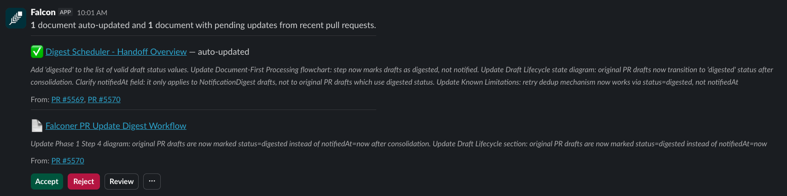
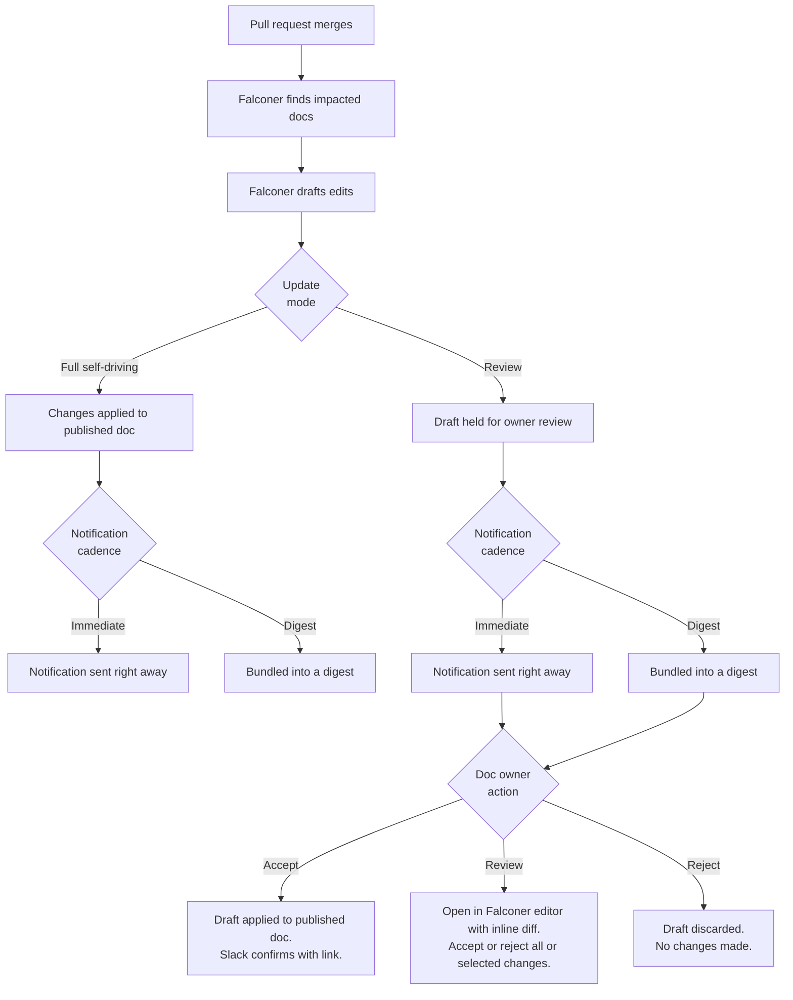

Turn on auto-update for any document and Falconer will keep it current, automatically. When a pull request merges, Falconer reads the PR, finds which docs are affected, and proposes changes for your review.

## Prerequisites

- **Pro subscription:** sign up for a free trial at <https://falconer.com/pricing>
- **GitHub integration:** GitHub App installed with repositories connected to Falconer so Falconer can detect updates
- **Slack integration (optional):** Falconer agent connected with DM permissions enabled to receive notifications in Slack. Notifications also appear in your Falconer inbox.
- **Owner or reviewer:** document owners and auto-update reviewers receive notifications (document creators are owners by default)
- **Document placement:** auto-update works on documents in your company navigation or the Files view. Documents in a private section are excluded.

## Enable auto-update

Auto-update is off by default. When you publish a doc, a banner appears at the top of the editor to toggle it on.

To turn it on or off for a document if you have dismissed the banner:

1. Open the document in the editor
2. Click the more button on top right corner, and select **Details** in the right sidebar
3. Under **Auto-update**, turn on **Enabled**

To turn on auto-update for every document in a folder or Space, see [Auto-update folders and Spaces](/update/auto-update-folders-and-spaces).

## How it works

When you first toggle on auto-update, we will run an initial workflow to update your doc immediately.

When a pull request merges in a connected repository:

1. Falconer search identifies impacted documents
2. Falconer proposes edits for the impacted document
3. Document owners and auto-update reviewers are notified in their Falconer inbox and by Slack DM, with a summary and action buttons

## Update mode

When you enable auto-update, the default mode is **Full self-driving mode**. Falconer applies changes to the document immediately without a review step.

You can switch to **Review mode** in the Details panel. In this mode, Falconer holds proposed changes for review and notifies the document owner and auto-update reviewers.

A document can also get its mode from its folder or Space. See [Update modes and reviewers](/update/auto-update-folders-and-spaces#update-modes-and-reviewers).

## Multiple PRs, one document

When multiple pull requests affect the same document before you’ve reviewed pending changes, Falconer reconciles them into a single consolidated draft. You review one set of changes instead of one per PR.

## Troubleshooting

**Not receiving notifications**

- Confirm you are the document owner or an auto-update reviewer
- Check that Slack DM permissions are enabled for the Falconer bot
- Verify the GitHub integration is active and the repository is connected

**Document not picked up by auto-update**

- Confirm auto-update is on in the Details panel. If the document follows a folder or Space, the panel shows where the setting comes from.
- Check that the document is not in a private section
- If the document or its folder has sharing that restricts editing, folder and Space settings do not reach it. Turn auto-update on for the document directly.