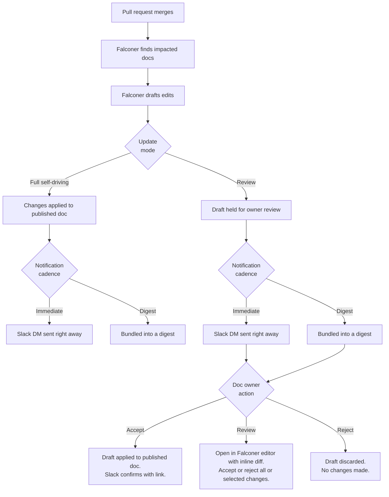

Turn on auto-update for any document and Falconer will keep it current, automatically. When a pull request merges, Falconer reads the PR, finds which docs are affected, and proposes changes for your review.

## Prerequisites

- **Pro subscription** - Sign up for a free trial at [https://falconer.com/pricing](https://falconer.com/pricing)
- **GitHub integration** — GitHub App installed with repositories connected to Falconer so Falconer can detect updates
- **Slack integration** — Falconer agent connected with DM permissions enabled to receive notifications
- **Document ownership** — you must be the document owner to receive notifications (document creators are owners by default)
- **Document visibility** — auto-update only works on documents with org-wide or public visibility; private documents are excluded

## Enable auto-update

Auto-update is off by default. When you publish a doc, a banner appears at the top of the editor to toggle it on.

To turn it on or off for a document if you have dismissed the banner:

1. Open the document in the editor
2. Click the more button on top right corner, and select **Details** in the right sidebar
3. Toggle **Auto-update** on

``

## How it works

When you first toggle on auto-update, we will run an initial workflow to update your doc immediately.

When a pull request merges in a connected repository:

1. Falconer search identifies impacted documents
2. Falconer proposes edits for the impacted document
3. Document owners are notified by Slack DM with a summary and action buttons

## Update mode

When you enable auto-update, the default mode is **Full self-driving mode** — Falconer applies changes to the document immediately without a review step.

You can switch to **Review mode** in the Details panel. In this mode, Falconer holds proposed changes for your review and notifies you in Slack.

## Multiple PRs, one document

When multiple pull requests affect the same document before you’ve reviewed pending changes, Falconer reconciles them into a single consolidated draft. You review one set of changes instead of one per PR.

## Troubleshooting

**Not receiving notifications**

- Confirm you are listed as the document owner
- Check that Slack DM permissions are enabled for the Falconer bot
- Verify the GitHub integration is active and the repository is connected

**Document not picked up by auto-update**

- Confirm auto-update is toggled on in the Details panel
- Check that the document is not set to private visibility
