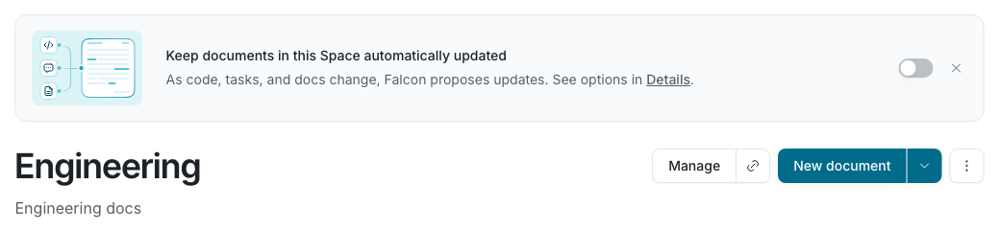
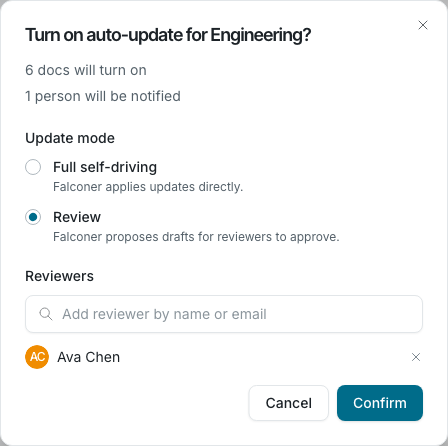
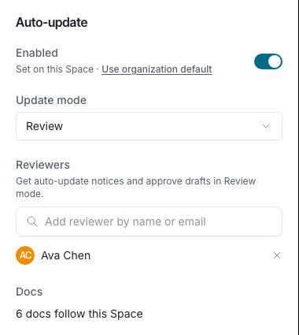
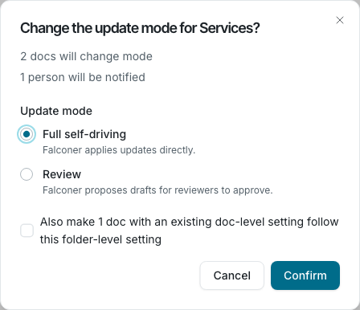
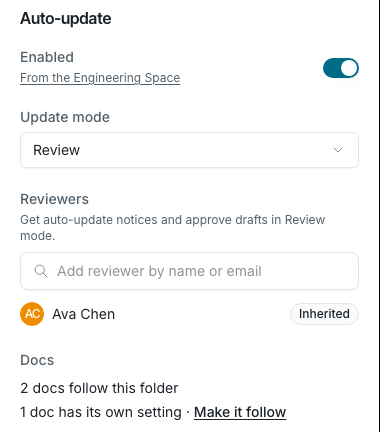
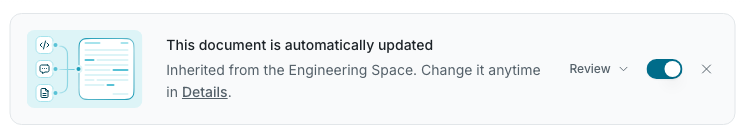
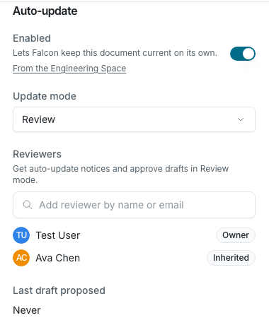
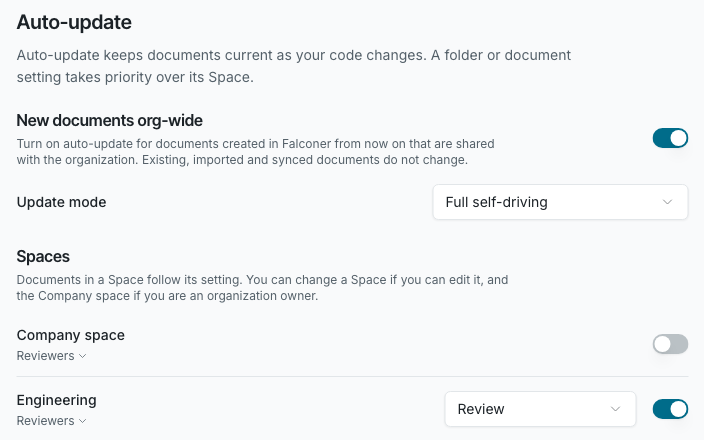
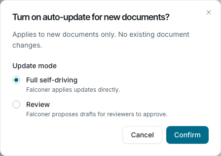
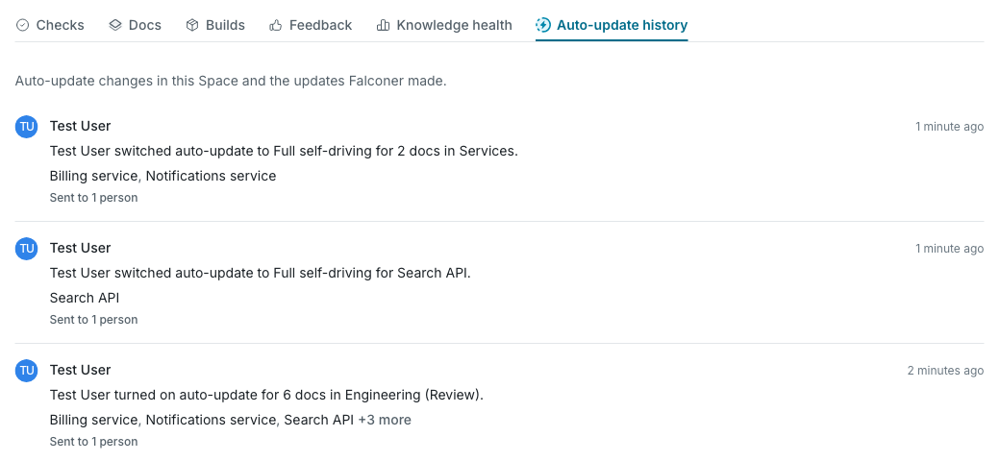

You do not have to turn on auto-update one document at a time.
Turn it on for a folder, a Space, the Company space or every new document, and the documents inside follow that setting.
A document can still have its own setting.

This page builds on [Automatically update documents](/update/auto-update-docs), which explains how Falconer updates a document when a pull request merges.

## Prerequisites

- **GitHub integration:** repositories connected to Falconer, so merged pull requests can update your docs
- **Edit access:** you need edit access to change a folder, a Space or a document. Only organization owners can change the Company space and the default for new documents.

## How a document gets its setting

Falconer checks these places in order and uses the first one that has a setting:

1. The document's own setting
2. The nearest folder above the document, up to and including its Space
3. The Company space, for documents in the Company space
4. The default for new documents, if it was on when the document was created
5. Off

The update mode follows the same order on its own.
For example, a document can follow its Space for on or off and still use its own mode.
When nothing sets a mode, the mode is **Full self-driving**.

Some documents are not reached by folder and Space settings:

- **Folders and documents whose sharing restricts editing.** Settings from above stop at a folder whose sharing restricts editing, so set auto-update on that folder itself. A document whose own sharing restricts editing follows no folder at all. Turn auto-update on for it directly.
- **Documents in a private section.** Auto-update does not run on private documents.
- **Files in the Files view that are not in the Docs view.** Turn auto-update on from the file.

When you move a document, its own setting moves with it.
A document that follows its folder picks up the setting of its new folder.
Moving a document into a private section turns auto-update off for it.

## Turn on auto-update for a folder or Space

When auto-update is off, a banner at the top of the folder or Space offers to turn it on.



To turn it on from the banner, use the toggle.
To see all the options:

1. Open the folder or Space.
2. Click the more button (**⋮**) and select **Details**.
3. Under **Auto-update**, turn on **Enabled**.
4. Review the summary in the confirmation dialog, choose an **Update mode** and, for **Review**, add reviewers.
5. Click **Confirm**.



The confirmation dialog shows what the change does before anything changes:

- How many documents will turn on, turn off or change mode
- How many people will be notified
- Documents that are not reached because their own sharing restricts editing
- Files that are not included because they are not in the Docs view

Every change to a folder, a Space, the Company space or the default for new documents asks for this confirmation.

After you confirm, the **Auto-update** section of the Details panel shows the new setting.



### Make every document follow the folder

Documents that have their own setting keep it when you change the folder.
To make them follow, select **Also make N docs with an existing doc-level setting follow this folder-level setting** in the confirmation dialog.



You can also click **Make them follow** next to the document count in the Details panel.

### Read the Details panel

The **Auto-update** section of a folder or Space shows:

| Field | What it shows |
| --- | --- |
| **Enabled** | Whether auto-update is on, and where the value comes from, for example **From the Engineering Space** or **Set on this folder**. **Inherit instead** (folder) or **Use organization default** (Space) removes the folder's own setting. |
| **Update mode** | **Full self-driving** or **Review** |
| **Reviewers** | People who get auto-update notices and approve drafts in Review mode. Reviewers from a parent folder or Space are tagged **Inherited**. |
| **Docs** | How many documents follow this folder, how many have their own setting and how many are not reached |



## Change one document

A document that follows a folder or Space shows where its setting comes from.
The banner at the top of the document and the **Auto-update** section in **Details** both show the source.



To give a document its own setting, change **Enabled** or **Update mode** in its **Details** sidebar.
To make it follow its folder again, click **Use folder setting**.



Anyone who can edit a document can change its auto-update setting.
An organization owner who cannot edit a document can still turn auto-update off for it.

## Set organization defaults

Organization owners can set defaults in **Settings → Organization settings → Auto-update**.



- **New documents org-wide:** turns on auto-update for documents created in Falconer from now on that are shared with the organization. Existing, imported and synced documents do not change. A document keeps this setting from the day it was created, and a folder or Space setting takes priority over it.
- **Spaces:** turns auto-update on or off for the Company space and for each Space, with its update mode and reviewers. You can change a Space if you can edit it. Only organization owners can change the Company space.

When you turn on **New documents org-wide**, you choose the update mode for new documents.



The new documents default sets the mode only.
Reviewers are chosen on each document, folder or Space.

## Update modes and reviewers

| Mode | What happens |
| --- | --- |
| **Full self-driving** | Falconer applies updates directly. Owners and reviewers get a notice of what changed. |
| **Review** | Falconer proposes drafts. Owners and reviewers approve or reject them. |

- The document owner is always a reviewer.
- Add more reviewers on a document, a folder, a Space or the Company space. Reviewers of a folder or Space are reviewers of every document that follows it.
- If a change turns on auto-update for a document that has nobody to notify, Falconer adds you as a reviewer.

The document **Details** sidebar has two sections called **Reviewers**.
The one under **Auto-update** is for auto-update drafts.
The other one asks coworkers to review the document itself and is not related to auto-update.

## Notifications

Owners and reviewers get these notifications.
Each one goes to the inbox and to Slack by default, not to email.
Change them in **Settings → Personal settings → Notifications**.

| Notification | When you get it |
| --- | --- |
| **Auto-update settings changed** | Someone turns auto-update on or off, or changes its mode, for documents you own or review. You get one notice per change, with the documents it affects. |
| **Added as an auto-update reviewer** | Someone makes you a reviewer for a document, a folder or a Space. You do not get it when you add yourself. |
| **Auto-applied document updates** | Falconer applied an update to a document in Full self-driving mode. |
| **Document drafts proposed by GitHub PRs** and **Document update digest** | Falconer proposed drafts that need your approval in Review mode. They come right away or in a digest, based on your organization's notification cadence. |

The person who makes a change does not get a notice about it.

## See the auto-update history

A Space with a [public docs site](/public-docs/overview) has an **Auto-update history** tab on its dashboard.
It lists, newest first, the auto-update setting changes in the Space and the updates Falconer made: updates applied, drafts left for review and digests.
Each entry shows who did it, what changed, which documents it affected and how many people were notified.



You need edit access to the Space to see the history.
It leaves out documents you cannot see.

For other Spaces, read the history from MCP, the API or the CLI.

## Use auto-update from MCP, the API and the CLI

Agents connected through [MCP](/mcp-and-cli/quickstart) and scripts that use the API can make the same changes.
Every folder, Space and organization change needs `confirmed: true`.
Without it, nothing changes and the response is a preview of the change, so the agent can show it to you first.

| Task | MCP | API |
| --- | --- | --- |
| Change a folder | `update_folder` | `PATCH /folders/{folderId}` |
| Change a Space | `update_space` | `PATCH /spaces/{spaceId}` |
| Change a document | `edit_settings` with the `document` scope | `PATCH /docs/{id}/metadata` |
| Change organization defaults | `edit_settings` with the `org` scope | `PATCH /settings/org` |
| List or change reviewers | `list_auto_update_approvers`, `update_auto_update_approvers` | `GET` or `PUT` on `/docs/{id}/approvers`, `/folders/{folderId}/approvers` and `/default-space/approvers` |
| Read a Space's history | `list_auto_update_history`, `list_auto_update_history_documents` | `GET /spaces/{spaceId}/auto-update-history` |

- `autoUpdateEnabled` takes `true`, `false` or `null`. `null` removes the folder's own setting so it follows its parent.
- `autoUpdateMode` takes `auto_apply` (Full self-driving), `draft_approval` (Review) or `null`. On a document, the mode field is `docUpdateMode`.
- `resetAutoUpdateOverrides: true` makes the documents and subfolders inside follow the new setting.
- Without `confirmed: true`, the API returns `409` with the code `confirmation_required` and the preview.

In the CLI (version 0.2.34 and later):

```bash
falconer folder update <folder-id> --auto-update on --mode review
falconer space update <space-id> --auto-update inherit --reset-overrides
falconer approvers <doc-id> --add <user>
falconer space history <space-id>
```

Without `--yes`, the CLI prints the preview and changes nothing.
Run the same command again with `--yes` to apply it.
