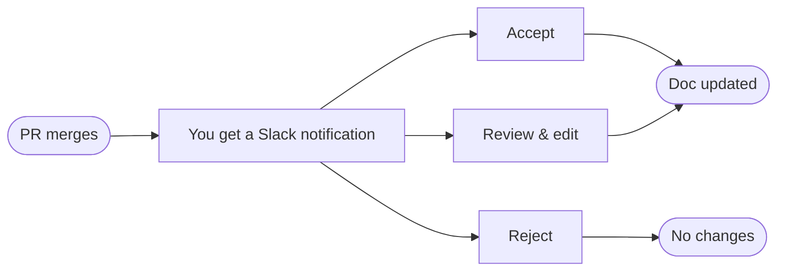

Get notified when pull requests impact your docs.

Falconer automatically detects when a merged pull request impacts your existing documentation and proposes targeted updates -- delivered straight to document owners through Slack.

> **Note:** Automatic doc updates is a new feature. Contact us at [support@falconer.com](mailto:support@falconer.com) for a demo.

## Prerequisites

Before enabling automated documentation updates, make sure you have:

- [Connected your GitHub App and Slack workspace](/docs/set-up/connect-sources) to Falconer
- Been assigned as an owner of the documents you want to receive updates for

## How it works

When a PR merges, Falconer analyzes the code changes, identifies which documents are affected, drafts proposed updates, and notifies the right people. Owners can accept, review, or reject changes without leaving Slack.

## Update notifications

If a PR impacts a doc you own, you'll receive a notification in Slack.

**Accept** -- Changes apply immediately to the document.

**Review** -- Opens the document in the Falconer editor with a **side-by-side diff** of the proposed changes. You can make manual edits before accepting or rejecting.

**Reject** -- Discards the proposed changes entirely.
