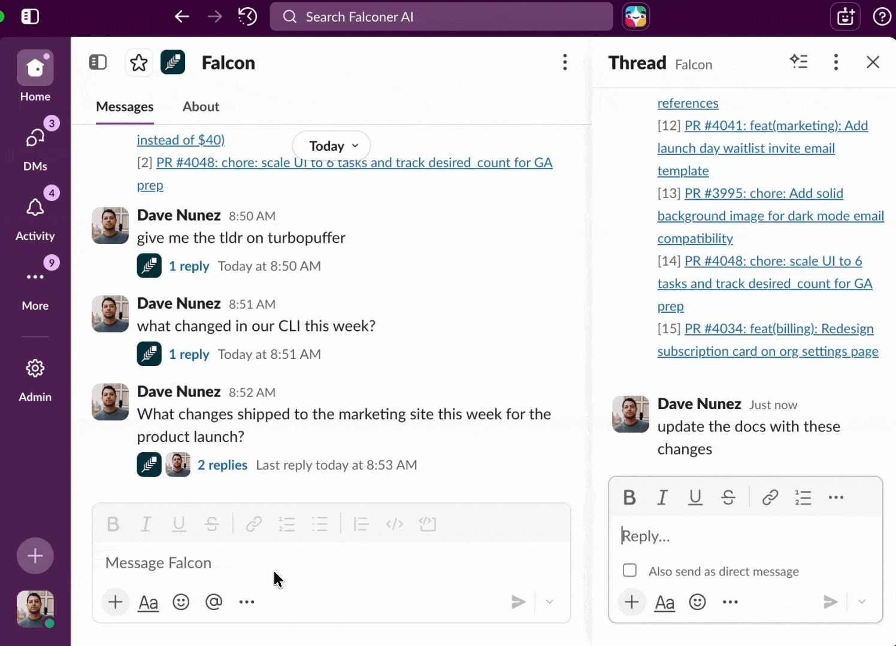

Update your Falconer docs directly from Slack conversations.

## Prerequisite

Ensure [Slack is connected](/set-up/connect-sources) to your Falconer org.

## Update a doc

Mention `@falcon` and it will search your organization's documentation, identify the right document, and apply targeted edits based on the conversation context.



To update a doc:

1. Mention Falcon with your update request. For example:

```
@Falcon update the runbook with the new staging deploy steps
```

2. Falcon analyzes the conversation and searches for matching docs
3. Falcon identifies the correct document(s)
4. Confirm docs you want to update

## How changes are applied

What happens after you confirm depends on your organization’s Slack setting:

- **Apply directly** (the default): Falcon edits the doc right away. It saves a snapshot of the doc first, so you can restore the earlier version from the doc’s history. Doc owners are notified of the change.
- **Draft for approval:** Falcon creates a draft instead. Doc owners get a request to review and approve it before it goes live.

If you change your mind before confirming, click **Cancel**. No changes are made.

## Tips for better updates

- **Be specific in your request.** Tell Falcon which doc to update and what information to add. The more context you provide, the more accurate the update.
- **Reference the doc by name.** If you know the document title, include it in your message to skip the selection step.
- **Use threads.** Falcon reads the full thread context, so reply in a thread where the relevant discussion happened.
- **Update tables from Slack.** Falcon handles structured content like tables -- mention the specific rows or columns to change.