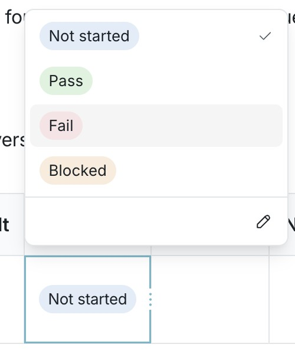

# Use structured tables

Tables keep related information together in a Falconer doc. Give a column a type when every row should hold the same kind of value, such as a date, amount, or status. For a simple comparison, plain text columns are enough.

## Create a table

1. Open a doc you can edit and place the cursor where the table belongs.
2. Type **/** and choose **Table** from the command menu.
3. Enter column headings and add rows for your information. For example, make a launch tracker with **Initiative**, **Owner**, **Budget**, **Target date**, **Priority**, and **Done**.

## Set column types

1. Open a column header’s menu and choose **Type**.
2. Select **Text**, **Number**, **Email**, **Phone**, **URL**, **Checkbox**, **Date**, **Options**, or **Reference**. A header icon shows the selected type.
3. Enter values in the cells. For a budget, choose **Number**, then use its number-format menu to display currency. For a deadline, choose **Date** and use the date picker. For priority, choose **Options** and edit the available options. Use **Checkbox** for a done/not-done column.

A number’s display format can change without changing its stored value. Dates can include an end date or time. If an existing cell cannot fit the type you chose, the change is refused; correct that cell before trying again. Invalid typed values are highlighted with an explanation on hover.

## Keep the table useful

- Use the header menu’s **Sort** option to order rows. Number, date, checkbox, and options columns sort by their values or option order.
- Add or delete rows and columns from the table’s context menu. Select cells to merge them when a heading needs to span columns; split a merged cell to restore individual cells.
- For a person, document, task, or pull request you want to link, choose **Reference**. Add a separate **Lookup** column to show an attribute of that reference, such as a task’s status or assignee. To correct a lookup, update its reference rather than typing over the displayed value.

Ask Falcon to make a targeted change when a table is long. For example: “In the launch tracker, mark Docs launch done and add Search refresh with a target date.” Review a proposed change before accepting it. For rows that should come from a work tool rather than be maintained by hand, [sync a table with work](/write/sync-a-table-with-work).